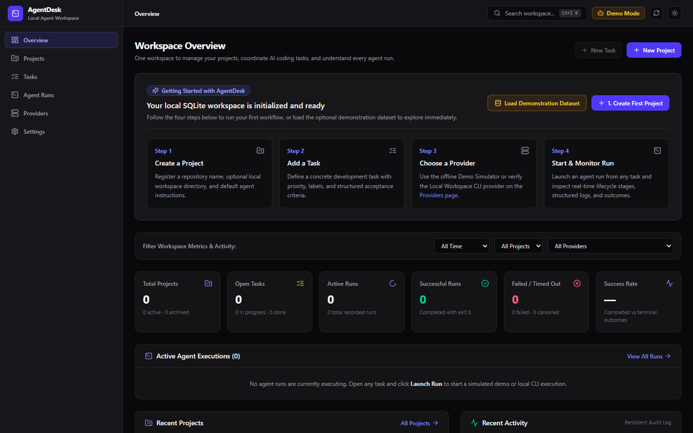
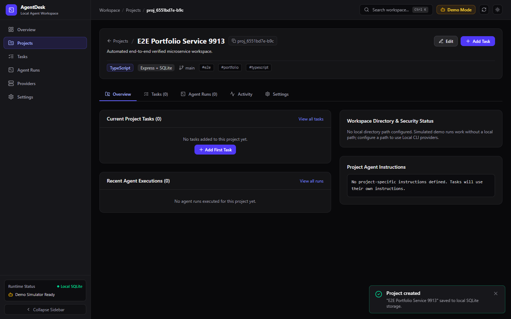
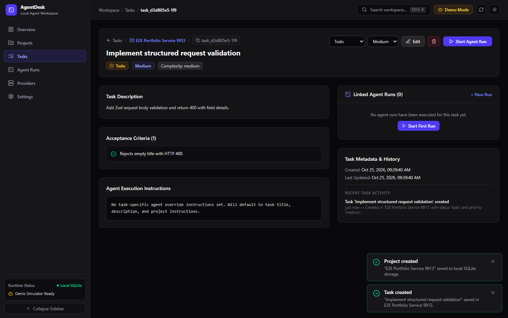
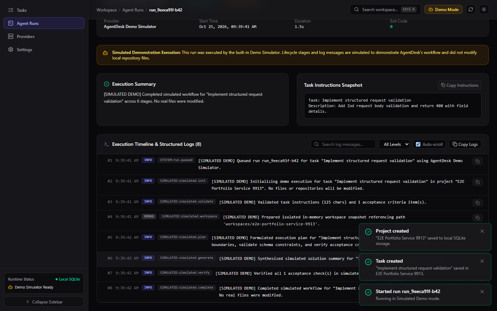
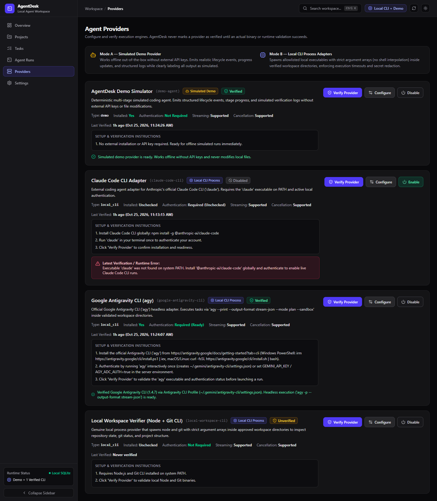

# AgentDesk

> **"One workspace to manage your projects, coordinate AI coding tasks, and understand every agent run."**

AgentDesk is a local-first AI coding agent management and development workflow platform built with **React 19, TypeScript, Vite, Tailwind CSS, Node.js, Express, Drizzle ORM, and SQLite**.

It provides software developers with a centralized operations workspace to organize repositories, define structured development tasks with multi-item acceptance criteria, configure and verify agent providers, launch simulated or real local CLI agent runs, stream live execution events, and inspect diagnostic logs.

---

## Table of Contents

1. [Product Overview](#1-product-overview)
2. [Implemented Features](#2-implemented-features)
3. [Screenshots](#3-screenshots)
4. [Technology Stack](#4-technology-stack)
5. [Architecture & Database Schema](#5-architecture--database-schema)
6. [Prerequisites & Installation](#6-prerequisites--installation)
7. [Configuration (`.env.example`)](#7-configuration-envexample)
8. [Running Locally](#8-running-locally)
9. [Execution Modes: Demo Simulator vs. Real Local CLI](#9-execution-modes-demo-simulator-vs-real-local-cli)
10. [Security Controls](#10-security-controls)
11. [Testing Suite](#11-testing-suite)
12. [REST API Reference](#12-rest-api-reference)
13. [Limitations & Roadmap](#13-limitations--roadmap)
14. [Troubleshooting](#14-troubleshooting)

---

## 1. Product Overview

Developers increasingly rely on AI coding agents to work across multiple software repositories. However, tracking which tasks are ready for an agent, what instructions were given, which runs succeeded or failed, and why a run failed quickly becomes fragmented.

AgentDesk answers five critical developer workflow questions in one place:

1. **What projects am I currently working on?**
2. **What tasks need attention?**
3. **Which agent runs are active, completed, failed, or waiting?**
4. **What happened during each run, and why did it fail if something went wrong?**
5. **What should I work on next?**

---

## 2. Implemented Features

- **Workspace Overview Dashboard:**
  - Database-backed metrics (Total Projects, Open Tasks, Active Runs, Completed Runs, Failed/Timed-Out Runs, and Success Rate calculated strictly from terminal completed vs. failed/timed-out outcomes).
  - First-run onboarding guide with a 4-step walkthrough and an optional one-click **Load Demonstration Dataset** action.
  - Real-time Active Agent Executions monitor with live stage progress and instant cancellation.
  - Recent Projects summary and persistent Workspace Activity audit feed.
- **Project Management:**
  - Table and Card views with search, tag filters, archive status filters, and sorting (`updatedAt`, `createdAt`, `name`).
  - Full CRUD with local workspace path validation against the configured `APPROVED_WORKSPACE_ROOT`.
  - Project Detail screen with **Overview, Tasks, Agent Runs, Activity, and Settings** tabs.
  - Safe deletion policy with explicit confirmation detailing how many linked tasks and runs will be removed, alongside non-destructive archiving.
- **Task Management:**
  - **List View** and interactive **Kanban Board** (supporting drag-and-drop and accessible status menus across `Backlog`, `Todo`, `In Progress`, `In Review`, `Done`, and `Cancelled`).
  - Priorities (`Low`, `Medium`, `High`, `Urgent`), complexity labels, due dates, and multi-item **Acceptance Criteria** builder.
  - Task Detail view showing linked agent runs, historical outcomes, and a **Launch Agent Run** modal.
- **Agent Provider System:**
  - Pluggable `AgentProvider` interface and `ProviderRegistry` separating execution adapters from HTTP controllers.
  - Honest verification gate: providers are only marked `Verified` after passing an active runtime/binary check (`POST /api/providers/:providerId/test`).
- **Agent Runs & Live Diagnostics:**
  - Enforced lifecycle state machine (`queued` → `starting` → `running` → `completed` | `failed` | `cancelled` | `timed_out`).
  - Live updates via **Server-Sent Events (`GET /api/runs/:runId/events`)** and automatic React Query synchronization.
  - Structured log viewer with log-level filtering (`debug`, `info`, `warn`, `error`), full-text search, source tags (`SIMULATED`, `STDOUT`, `STDERR`, `SYSTEM`), auto-scroll toggle, clipboard copy, and `JSON` / `TXT` run export.
  - Non-destructive **Retry** workflow that creates a new run linked via `retryOfRunId` while preserving prior run history.
- **Global Search & Productivity:**
  - `Ctrl + K` / `Cmd + K` global search modal across projects, tasks, and agent runs.
  - Persistent Dark/Light theme and workspace settings stored in SQLite.

---

## 3. Screenshots

| Workspace Overview Dashboard | Project Detail & Workspace Verification |
| :---: | :---: |
|  |  |

| Task Detail & Acceptance Criteria | Agent Run Timeline & Structured Logs |
| :---: | :---: |
|  |  |

| Agent Providers & Verification Gate |
| :---: |
|  |

---

## 4. Technology Stack

| Layer | Technologies |
| :--- | :--- |
| **Frontend (`apps/web`)** | React 19, TypeScript (Strict), Vite 6, Tailwind CSS 4, React Router 7, TanStack Query v5, React Hook Form, Zod, Lucide Icons |
| **Backend (`apps/api`)** | Node.js (`>=22.5.0`, tested on `v24.16.0`), Express 4, TypeScript (`NodeNext`), Zod Validation, Helmet, Narrow CORS, Structured JSON Logger |
| **Database** | Local SQLite (`node:sqlite` in WAL mode with foreign keys + Drizzle ORM `sqlite-proxy` schema & versioned SQL migrations) |
| **Testing** | Vitest, Supertest (API Integration & Persistence), React Testing Library + JSDOM (Frontend UI), Playwright (End-to-End Browser Verification) |

---

## 5. Architecture & Database Schema

See [`docs/ARCHITECTURE.md`](docs/ARCHITECTURE.md) for the complete Mermaid architecture diagram, entity-relationship (ER) diagram, and run lifecycle state machine.

```text
agentdesk/
├── apps/
│   ├── api/                        # Express + TypeScript REST API & Agent Runtime
│   │   └── src/
│   │       ├── agents/
│   │       │   ├── adapters/       # DemoAgentProvider, LocalWorkspaceCliProvider, ClaudeCodeCliProvider
│   │       │   ├── interfaces/     # Strongly typed AgentProvider contract
│   │       │   └── registry/       # ProviderRegistry & verification gate
│   │       ├── config/             # Zod environment variable validation
│   │       ├── controllers/        # HTTP request handlers
│   │       ├── database/
│   │       │   ├── migrations/     # Versioned SQL migrations & runner
│   │       │   ├── schema/         # Drizzle ORM table definitions
│   │       │   └── seed/           # Idempotent demonstration dataset seeder
│   │       ├── middleware/         # Centralized error handler & Zod validators
│   │       ├── repositories/       # SQLite repositories (Projects, Tasks, Runs, Providers, Settings, Activity)
│   │       ├── routes/             # Express API router
│   │       ├── services/           # RunService lifecycle orchestrator & SSE emitter
│   │       └── utils/              # Secret redaction, workspace path confinement, structured logger
│   └── web/                        # React 19 + Vite + Tailwind CSS Developer Dashboard
│       └── src/
│           ├── components/         # Layout shell, status badges, modals, global search, toast system
│           ├── features/           # Dashboard, Projects, Tasks, Runs, Providers, Settings pages
│           ├── lib/                # Formatting & status helpers
│           ├── services/           # Typed REST API client
│           └── types/              # Shared domain interfaces
├── docs/                           # Architecture reference, OpenAPI spec, and screenshots
├── tests/                          # Playwright E2E test suite
├── .env.example                    # Documented environment variable template
└── package.json                    # Monorepo scripts and workspace configuration
```

---

## 6. Prerequisites & Installation

### Prerequisites
- **Node.js:** `v22.5.0` or newer (tested on **Node.js `v24.16.0`** on Windows, which includes native `node:sqlite` support with zero C++ build-tool dependencies).
- **npm:** `v10+` (tested on `v11.13.0`).
- **Git:** Installed on `PATH` (`git --version`) for local workspace inspection.

### Installation Steps

```powershell
# 1. Install all monorepo dependencies
npm install

# 2. Copy the environment configuration template (optional — sensible local defaults are built in)
Copy-Item .env.example .env

# 3. Apply SQLite database migrations
npm run db:migrate

# 4. (Optional) Seed realistic demonstration projects, tasks, and sample runs
npm run db:seed
```

---

## 7. Configuration (`.env.example`)

All environment variables are validated at startup via Zod (`apps/api/src/config/env.ts`):

| Variable | Default | Description |
| :--- | :--- | :--- |
| `NODE_ENV` | `development` | Runtime mode (`development`, `test`, `production`) |
| `PORT` | `3001` | Backend API listening port |
| `HOST` | `127.0.0.1` | Localhost binding (prevents accidental public exposure) |
| `CORS_ORIGIN` | `http://localhost:5173` | Allowed frontend origin |
| `DATABASE_URL` | `./data/agentdesk.sqlite` | Path to persistent SQLite database file |
| `APPROVED_WORKSPACE_ROOT` | Repo root directory | Security boundary for local CLI process execution |
| `DEFAULT_EXECUTION_TIMEOUT_MS` | `60000` | Default process execution timeout (ms) |
| `MAX_LOG_PAYLOAD_BYTES` | `65536` | Max bytes per log message/metadata payload |

---

## 8. Running Locally

### Development Mode (Frontend + Backend with Hot Reload)

```powershell
npm run dev
```
- **Frontend UI:** `http://localhost:5173` (proxies `/api` requests to `http://127.0.0.1:3001`)
- **Backend API:** `http://127.0.0.1:3001/api/health`

### Production Build & Start

```powershell
# Compile TypeScript backend and build optimized Vite frontend bundle
npm run build

# Start production server (serves API and static frontend if NODE_ENV=production)
npm run start
```

### All Available Scripts

| Command | Description |
| :--- | :--- |
| `npm run dev` | Starts API (`:3001`) and Web (`:5173`) concurrently |
| `npm run build` | Builds `@agentdesk/api` and `@agentdesk/web` |
| `npm run start` | Runs compiled backend (`apps/api/dist/server.js`) |
| `npm run typecheck` | Runs `tsc --noEmit` across both workspaces |
| `npm run lint` | Runs ESLint across all `.ts` and `.tsx` source files |
| `npm test` | Runs all backend unit/integration/persistence tests and frontend UI tests |
| `npm run test:e2e` | Runs the Playwright end-to-end browser workflow test |
| `npm run db:migrate` | Applies versioned SQLite migrations |
| `npm run db:seed` | Loads idempotent demonstration projects, tasks, and runs |

---

## 9. Execution Modes: Demo Simulator vs. Real Local CLI

AgentDesk enforces strict transparency between simulated and real execution:

### Mode A — AgentDesk Demo Simulator (`demo-agent`)
- **Works 100% offline** without API keys or external tools.
- Emits 6 realistic lifecycle stages (`Initializing Execution`, `Validating Task Specifications`, `Preparing Virtual Workspace`, `Processing Task Instructions`, `Generating Simulated Result`, `Performing Simulated Validation`).
- Supports selectable outcomes (`Complete Successfully`, `Simulate Validation Failure`, `Simulate Step Timeout`) and stage pacing (`250ms`, `600ms`, `1400ms`) in the Launch Run modal so you can test both happy paths and failure diagnostics.
- Clearly badged with **`Simulated Demo`** across the UI and prefixed with `[SIMULATED DEMO]` in logs.

### Mode B — Real Local CLI Adapters (`local-workspace-cli`, `google-antigravity-cli`, & `claude-code-cli`)
1. **Local Workspace Verifier (`local-workspace-cli`):**
   - A genuine local CLI adapter powered by `child_process.spawn` (`shell: false`) using `node` and `git`.
   - Performs a read-only inspection of the target workspace directory (checking top-level structure, `package.json` scripts, and `git status --short --branch`), streaming real `stdout`/`stderr` lines and exit codes.
   - To use: Go to **Providers** → click **Verify Provider** on `Local Workspace Verifier (Node + Git CLI)` → launch a run from any task whose project has a valid local path inside `APPROVED_WORKSPACE_ROOT`.
2. **Google Antigravity CLI (`google-antigravity-cli` — Official `agy` CLI):**
   - Adapter for Google's official Antigravity CLI (`agy`) documented at `https://antigravity.google/docs/getting-started?tab=cli` and `https://antigravity.google/docs/cli/reference`.
   - Uses `agy`'s documented headless / non-interactive mode:
     ```text
     agy --print "<prompt>" --output-format stream-json --mode plan --sandbox
     ```
   - **Installation:**
     - **Windows (PowerShell):** `irm https://antigravity.google/cli/install.ps1 | iex`
     - **macOS / Linux:** `curl -fsSL https://antigravity.google/cli/install.sh | bash`
     - Confirm installation with `agy --version`.
   - **Authentication:**
     - **Interactive OAuth Sign-In:** Run `agy` once in a terminal to complete Google Sign-In (creates `~/.gemini/antigravity-cli/settings.json` and stores credentials in the OS keyring).
     - **Headless / Environment Authentication:** Set `GEMINI_API_KEY`, `AGY_ADC_AUTH=true` (Application Default Credentials), or `GOOGLE_APPLICATION_CREDENTIALS=/path/to/service-account.json` in the server environment.
     - AgentDesk never stores Google credentials, OAuth tokens, or API keys in SQLite provider configuration records.
   - **Configuration & Capabilities:**
     - Supports configurable `--output-format` (`stream-json` for NDJSON real-time progress events, `json`, or `text`), `--sandbox` terminal confinement, and execution timeout (`timeoutMs`).
     - Supports active process cancellation (`child.kill()`) and automatic secret redaction (`AIza...`, `ya29....`, Bearer tokens).
     - Clicking **Verify Provider** checks both `agy --version` and authentication readiness; if `agy` is missing on `PATH` or unauthenticated, AgentDesk reports `Unverified` with exact remediation instructions and disables selecting the provider in the Launch Run modal.
3. **Claude Code CLI Adapter (`claude-code-cli`):**
   - Adapter for Anthropic's official `claude` CLI (`@anthropic-ai/claude-code`).
   - Clicking **Verify Provider** runs `spawn("claude", ["--version"])`. If `claude` is not installed on the machine's `PATH`, AgentDesk honestly reports `Unverified` with clear installation prerequisites rather than faking a connection.

---

## 10. Security Controls

- **Zero Shell Interpolation:** Local CLI adapters exclusively use `child_process.spawn(executable, argsArray, { shell: false })`. User task descriptions are never interpolated into shell strings.
- **Automatic Per-Project Workspace Isolation:** When a project is created without an explicit `localPath`, AgentDesk automatically provisions an isolated directory under `workspaces/<project-slug>` rather than executing inside the AgentDesk application source tree. If an explicit `localPath` is provided, it is respected after security validation.
- **Workspace Path Confinement:** `validateWorkspacePath()` resolves candidate paths with `path.resolve()` and verifies they reside inside `APPROVED_WORKSPACE_ROOT` before any local process is spawned. Path traversal attempts (`../../`) are rejected with `403 FORBIDDEN_WORKSPACE`.
- **Credential Redaction:** `redactSecrets()` and `redactMetadata()` automatically scrub API keys (`sk-...`, `sk-ant-...`, `ghp_...`, `AIza...`), Bearer tokens, and secret-named keys from logs, provider configurations, and error responses.
- **Process Timeouts & Cancellation:** Every local process is guarded by a configurable timeout timer and an active `ChildProcess` registry supporting immediate user cancellation.

---

## 11. Testing Suite

Run the complete automated test suite with a single command:

```powershell
npm test
```

- **Backend Unit Tests (`apps/api/src/__tests__/unit.test.ts`):** Tests run lifecycle state machine transitions, project/task Zod schemas, provider registry gates, success-rate & duration math, secret redaction, and workspace path traversal blocking.
- **API Integration Tests (`apps/api/src/__tests__/api.integration.test.ts`):** Uses Supertest against an isolated `:memory:` SQLite database to test CRUD, validation errors, demo run execution, log retrieval, active run cancellation, non-destructive retry, and secret stripping.
- **Persistence & Real CLI Tests (`apps/api/src/__tests__/persistence-and-cli.test.ts`):** Verifies on-disk SQLite durability across database close/reopen and executes a genuine `local-workspace-cli` run via `child_process.spawn`.
- **Frontend UI Tests (`apps/web/src/__tests__/frontend.test.tsx`):** Uses React Testing Library to test project creation validation, task filtering, destructive confirmation modals, and navigation from Task Detail to Run Detail failure diagnostics.
- **End-to-End Browser Test (`tests/agentdesk.e2e.spec.ts`):** Uses Playwright to automate the full browser flow (`Create Project -> Create Task -> Start Demo Run -> Inspect Logs -> Reload & Verify Persistence`).

---

## 12. REST API Reference

See [`docs/openapi.json`](docs/openapi.json) for the full OpenAPI 3.1 specification.

| Method & Endpoint | Description |
| :--- | :--- |
| `GET /api/health` | Health check and execution mode summary |
| `GET /api/metrics` | Database-derived workspace summary metrics |
| `GET /api/search?q=...` | Global search across projects, tasks, and runs |
| `POST /api/seed` | Idempotently load demonstration dataset |
| `GET / POST /api/projects` | List (with search/tag/archive/sort) or create projects |
| `GET / PATCH / DELETE /api/projects/:projectId` | Get, update, archive, or delete a project |
| `GET / POST /api/tasks` | List (with search/project/status/priority/sort) or create tasks |
| `GET / PATCH / DELETE /api/tasks/:taskId` | Get, update, or delete a task |
| `GET / POST /api/providers` | List or register agent providers |
| `PATCH /api/providers/:providerId` | Update provider enabled state or non-secret config |
| `POST /api/providers/:providerId/test` | Run live verification check for a provider |
| `GET / POST /api/runs` | List runs or launch a new agent run |
| `GET /api/runs/:runId` | Get run details and status |
| `POST /api/runs/:runId/cancel` | Cancel an active run |
| `POST /api/runs/:runId/retry` | Retry a finished run (creates new linked run record) |
| `GET /api/runs/:runId/logs` | Query structured logs with level and search filters |
| `GET /api/runs/:runId/export?format=json\|txt` | Export run metadata and logs |
| `GET /api/runs/:runId/events` | Server-Sent Events (SSE) stream for live run updates |
| `GET / PATCH /api/settings` | Read or update persistent workspace settings |
| `POST /api/settings/validate-workspace` | Validate a directory path against `approvedWorkspaceRoot` |
| `GET /api/settings/export` | Export non-secret workspace metadata as JSON |
| `GET /api/activity` | Retrieve persistent workspace activity events |

---

## 13. Limitations & Roadmap

- **Single-User Local-First Model:** AgentDesk is designed for local single-developer use on `127.0.0.1` without cloud authentication. Exposing the server over a network would require adding authentication, RBAC, and TLS.
- **External AI CLI Prerequisites (`agy` / `claude`):** The `google-antigravity-cli` (`agy`) and `claude-code-cli` (`claude`) adapters require their respective official CLI binaries to be installed on the host `PATH` and authenticated locally (`agy` login / `GEMINI_API_KEY` or `claude` login). Note that installing the desktop **Antigravity IDE** (`Antigravity.exe`) alone does not install the standalone `agy` CLI binary onto `PATH`. Without external CLIs installed, `AgentDesk Demo Simulator` and `Local Workspace Verifier (Node + Git CLI)` remain 100% functional out of the box.
- **Future Roadmap:** Diff viewer for file changes made by local coding agents, Git worktree isolation per run, and webhook notifications.

---

## 14. Troubleshooting

- **Port `3001` or `5173` already in use:** Change `PORT` in `.env` and update the proxy target in `apps/web/vite.config.ts`.
- **Workspace path rejected (`403 FORBIDDEN_WORKSPACE`):** Open **Settings**, check your **Approved Workspace Root Directory**, and ensure the project's `localPath` is located inside that root directory.
- **Local CLI provider says "Not Verified":** Open **Providers** and click **Verify Provider** to run the binary check before launching a local run.
- **Google Antigravity CLI (`google-antigravity-cli`) reports `Executable 'agy' was not found on system PATH`:** Install the standalone `agy` CLI from `https://antigravity.google/docs/getting-started?tab=cli`, ensure the directory containing `agy` is on your `PATH`, and restart the AgentDesk server.
- **Google Antigravity CLI reports `authentication is not configured`:** Run `agy` interactively in a terminal once to sign in (creating `~/.gemini/antigravity-cli/settings.json`), or export `GEMINI_API_KEY` / `AGY_ADC_AUTH=true` before starting the backend server, then click **Verify Provider** again.
