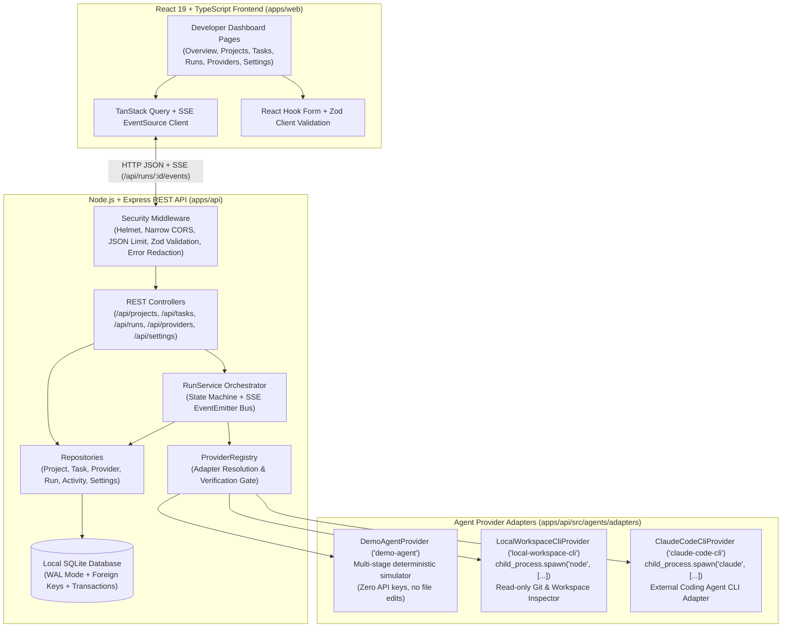
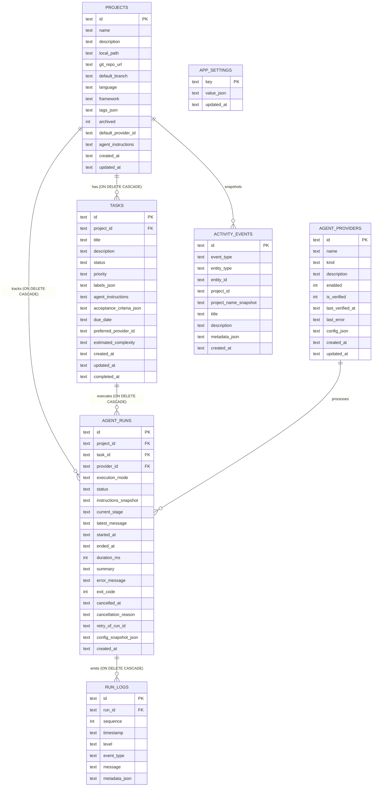
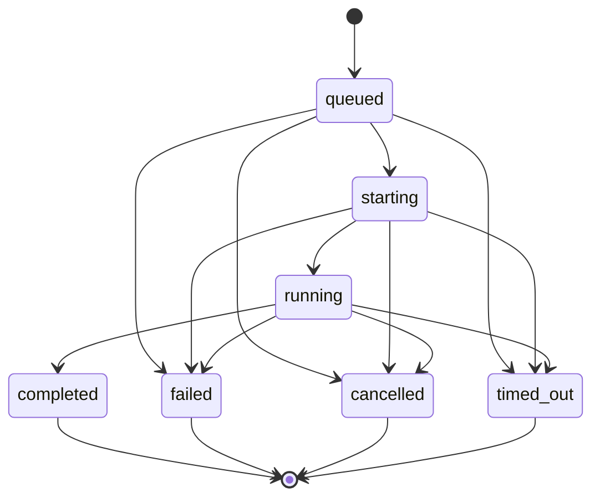

# AgentDesk — Architecture & Engineering Reference

## 1. System Architecture Diagram

---

## 2. Database Schema & Entity-Relationship Diagram

---

## 3. Agent Run State Machine

Every `AgentRun` follows a strictly enforced lifecycle state machine (`assertValidRunStatusTransition` in `apps/api/src/validators/schemas.ts`):

Terminal states (`completed`, `failed`, `cancelled`, `timed_out`) cannot transition back to active states. Retrying a run creates a **new** `AgentRun` record with `retry_of_run_id` referencing the prior run, preserving the full historical audit trail and logs.
